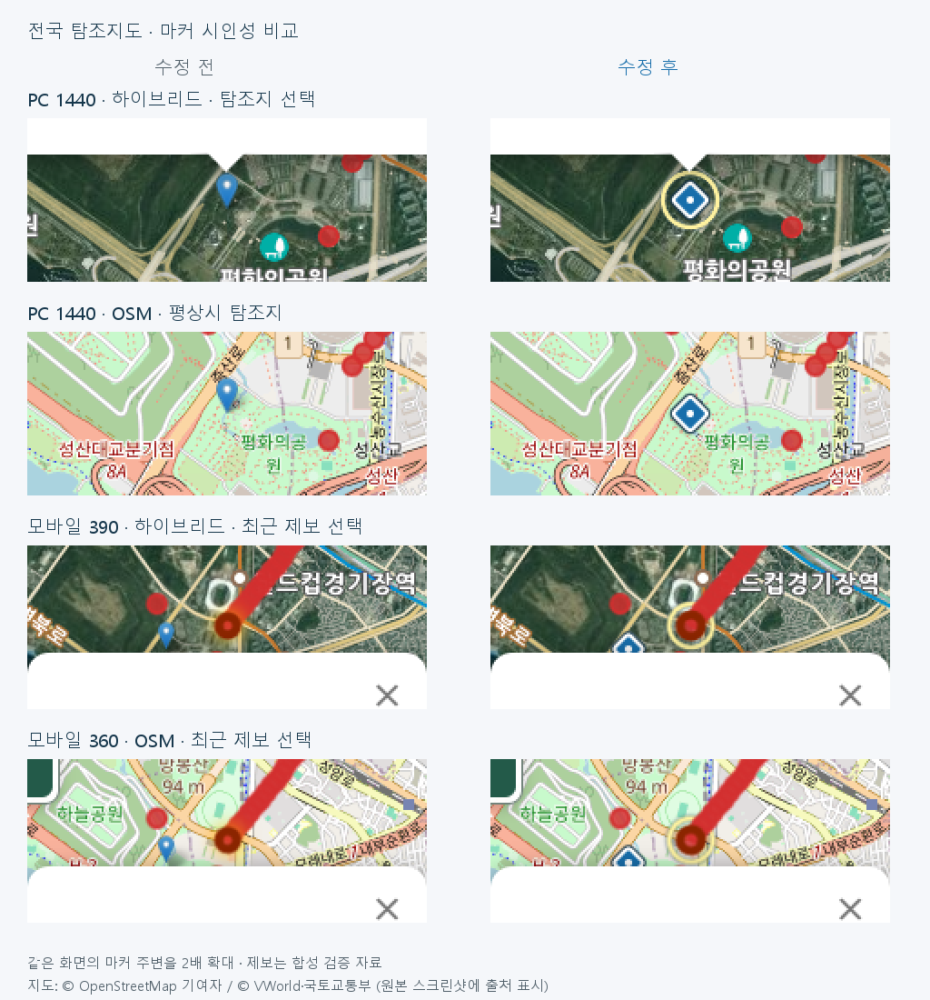

# PC·모바일 마커 시인성 개선 검증 (2026-11-01)

> 후속 검증: [실제 링 표시 수정·엄격한 계약 검사 보완·skipped CI 감사](followup/report.md). 최초 293건은 SVG 선 투명도를 확인하지 못했다. 후속 검사는 325건이며, 기존 주간 3건 외에 기준에서도 재현되는 wide 지도 실패 1건도 별도로 기록했다. 아래는 최초 구현 시점의 기록이다.

1. **목적** — OSM·하이브리드에서 탐조지와 지도 제공자의 지명 기호를 구별하고 선택한 출현종을 찾기 쉽게 한다.
2. **변경 파일** — `index.html` 연결부/마커 팩토리, `assets/birdmap-markers.js`·`.css`, 기존 종별 선택 CSS, PR의 기존 브라우저 검사 작업, 이 폴더의 검사·증거·비교 이미지.
3. **변경 내용** — 탐조지는 16px(모바일 14px) 흰 테두리 마름모와 44×44px 입력 상자. 기존 색 계열을 유지하며 선택할 때만 외곽 링. 출현종은 평상시 원형·색을 유지하고 선택 시 기존 진한 테두리, 반지름 5→5.5px, 밝은 링, 900ms×2의 은은한 퍼짐 효과. 다른 팝업·닫기·필터·갱신·공개 철회에서 해제. 제보 전용 pane으로 인접한 탐조지 입력 상자에 가리지 않으며 링은 입력을 받지 않는다. reduced-motion에서는 애니메이션 없이 고정 강조만 표시한다.
4. **테스트 결과** — 새 최종 마커 검사 293/293, 기준 전후 비교 검사 293/293, 실제 타일 촬영 상태 검사 37/37. 기존 GPS/팝업 420/420, 최근 제보 패널 96/96. 전체 전면 회귀 609개 중 606 통과, 기존 주간 추천 3개 실패(아래). Chrome의 모바일 터치 에뮬레이션이며 물리 기기 Safari 검증은 포함하지 않았다.
5. **좌표 검증** — 240개 탐조지의 ID 중복 없음, 각 런타임 마커 lat/lng와 siteData 일치. siteData·관찰 기록·고정 출현점·Worker 좌표·보호 정책 데이터는 수정하지 않았다.
6. **기존 기능 영향** — 최근 15건의 정확 ID 공개 검증을 그대로 사용한다. 비공개·보호종·만료·지연 응답 차단, GPS 안내/종료/회전 복원, 카카오·티맵 경로의 기존 회귀 검사 통과. 새로운 API 폴링이나 프레임별 JS 루프는 없다. 100회 연속 선택/닫기 166.6ms(이 PC의 한 번 측정); 지도 레이어 262→262, 남은 강조 0, 추가 공개 API 요청 0. 성능 수치는 다른 기기의 보증값이 아니다.
7. **미해결/검증 한계** — 주간 추천 검사 612·1799·1873행은 기준 df90011에서도 동일하게 실패(180개 중 177 통과). 가을 월을 모의하면서 실제 11월 1일 날짜를 사용하는 기존 계절 테스트의 불일치다. 요청 범위 밖이므로 수정하지 않았다. 작은 모바일 상세 패널이 마커를 덮는 기존 배치는 유지했다. 원본 위치에서 지도를 이동하면 링은 좌표를 따라 표시된다. 합성 제보 15건이 가까이 있어 확대 화면에서 붉은 점이 이어질 수 있다.
8. **Commit/Push 및 배포** — 작업 브랜치 `codex/marker-visibility-pc-mobile`에서 PR로 제공한다. main 병합 및 운영 배포는 하지 않는다. 정확한 커밋은 PR head를 따른다.

## 화면 행렬

| 구분 | 화면 |
|---|---|
| PC | 1440×900, 1440×1100 |
| 모바일 세로 | 320×568, 360×740, 390×844 |
| 모바일 가로 | 568×320, 740×360, 844×390 |

모든 조합에서 OSM·하이브리드, 탐조지 평상시/선택, 출현종 직접/최근 목록 선택, 닫기/다른 선택/회전/제거/갱신을 확인했다. 실제 지도 타일만 읽고, 제보·GPS·공개 상태는 합성 fixture를 사용했다. 생산 제보 등록·수정·전송은 없다.

## 비교



| 화면 | 수정 전 | 수정 후 |
|---|---|---|
| PC 하이브리드 탐조지 선택 | [원본](screenshots/1440x900-hybrid-before-site-selected.png) | [원본](screenshots/1440x900-hybrid-site-selected.png) |
| 모바일 390 하이브리드 최근 선택 | [원본](screenshots/390x844-hybrid-before-recent-selected.png) | [원본](screenshots/390x844-hybrid-recent-selected.png) |

전체 129개 원본(8개 화면×2개 지도×4개 상태×전후 + reduced-motion)은 작업 결과의 로컬 비교 갤러리에 포함한다. PR에는 대표 원본과 비교 이미지, [검증 요약](evidence.json)을 포함한다.

## 재현

Node 24, 설치된 Chrome, `playwright-core@1.62.1`을 사용한다. PowerShell 예:

```powershell
npm install --prefix .ci-toolchain --no-save --package-lock=false --no-audit --no-fund playwright-core@1.62.1
node .github/scripts/cache_gps_dependencies.mjs .ci-results/gps-dependencies
$env:PLAYWRIGHT_MODULE = (Resolve-Path .ci-toolchain/node_modules/playwright-core).Path
$env:POPUP_DEPENDENCY_CACHE = (Resolve-Path .ci-results/gps-dependencies).Path
$env:MARKER_AFTER_ONLY = '1'
node docs/marker-visibility/browser.cjs
```

전후 비교: 위의 MARKER_AFTER_ONLY를 해제하고 `MARKER_BASE_REF=df900110bb21be678e096fa3ded905359105b7ea` 및 `MARKER_SHOTS`를 지정한다(기준 Git 이력이 필요함). `MARKER_REAL_TILES=1`·`MARKER_CAPTURE_ONLY=1`은 실제 지도 타일을 읽는 촬영 모드다. 이 옵션 없이 외부 API·GPS·타일 요청은 차단되거나 합성 자료로 응답한다.
