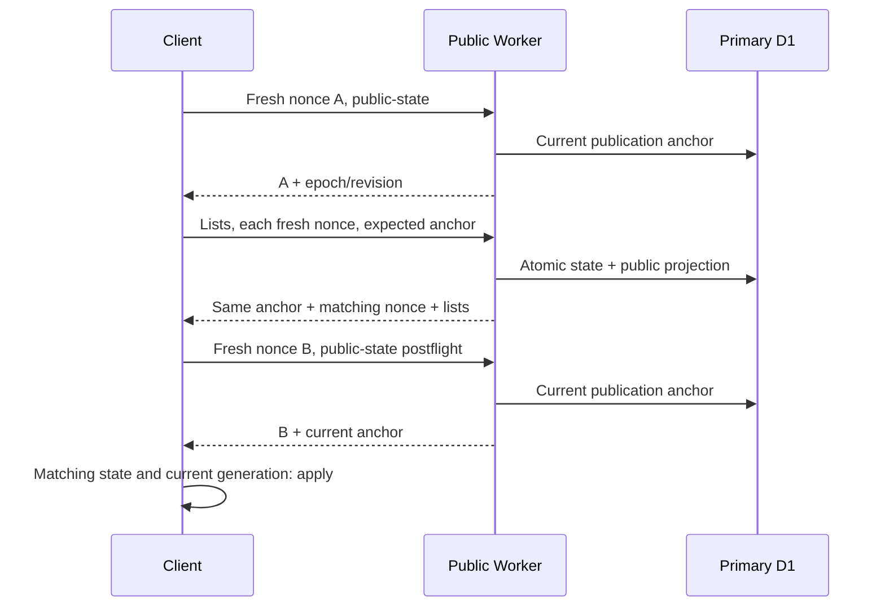

# 최소 변경 설계 — 승인 전 제안

## 1. 선택과 경계

기존 보호종·승인·대기·가림 정책을 그대로 두고 **기존 정책의 최신 서버 상태를 확인한 경우만 해당 공개 projection을 사용**한다. hidden 항목은 기존 대략점/길찾기제한을 유지한다. S1-R은 표현방어이며 승인된 보호종의전면비공개(S1-P)를추가하지않는다. normal report/field의재승인·hide=false·재출현은기존권한있는행위로허용한다.

|대안|장점|한계/판단|
|---|---|---|
|no-store+클라이언트요청순번만|스키마없음|첫과거응답·서버복원경합·이미날아오는응답을구별못함. 단독안기각|
|현재public snapshot의hash를매번primary에서재계산+nonce|지속카운터스키마불필요, current projected content동등성검사가능|매anchor에서전체projection을읽어야함; scope/시간만료/이력/빈목록까지동일한hash구성이필요. 검증대안이지만최소실행비용/유지보수선택아님|
|독립publication epoch/revision+nonce+원자snapshot+no-store|저렴한head,삭제/가림/철회/다기기변경포괄|추가D1상태·trigger와client gate필요. **권고**|

revision은권한내용서명이나사용자인증수단이아니다. HTTPS로연결된올바른서버·D1이신뢰경계다. 악성서버가과거내용에새nonce/revision을고의로붙이는공격은이계약만으로검증못한다. 브라우저가이미전달받은좌표/외부지도앱의기록을회수한다고보장하지않는다.

## 2. D1 최소 추가 상태

**필요:** (a)singleton public_publication_state 테이블1개, (b)field_updates.row_revision INTEGER 컬럼1개, (c)revision/terminal 안전trigger. 이파일은설계이며실행가능migration파일을추가하지않았다.

- singleton id=1, epoch=서버가생성한opaque값, revision=단조증가integer. 삭제·누락·자료형오류·overflow는공개조회fail closed. 응답revision은SQL CAST AS TEXT로정규십진문자열로전달, JS는엄격parser/BigInt(또는정규길이비교)로비교해2^53반올림금지.
- epoch는공개계약의bootstrap/비상복구세대를구분한다. 평소새배포마다바꾸지않고migration/데이터복구/read-source전환절차에서만명시변경한다. epoch변경시counter를작게되돌렸다고동일세대로비교하지않는다. 계약version/projection은서버코드의명시값이다.
- state row 삭제는 금지하고, revision trigger에서 singleton 존재·자료형·상한을 검사하여 누락/무효/overflow 시 원 mutation도 abort한다. 단순 UPDATE state가0행인 채 원 mutation을 성공시키지 않는다.
- reports INSERT/UPDATE/DELETE와field_updates INSERT/UPDATE/DELETE의AFTER trigger가같은DBtransaction에서globalrevision을증가시킨다. 첫버전은row-level변경마다증가하는넓은coverage를권고한다. 한논리batch에서revision이여러번뛸수있으며정확+1계약을만들지않는다. private-only업데이트도불필요재조회가발생하는비용/활동metadata노출을검토한다;최적화는별도승인.
- 공개소스는현재reports다. canonical dual의성공batch는reports를함께변경하므로trigger로포괄되고실패batch의counter도rollback된다. canonical-only 공개read-switch가현재없다는것을근거로checklists에새trigger를붙이지않는다. 미래전환은coverage+epoch/projection재설계선행조건이다.
- reports physical DELETE/purge도포괄한다. archive/restore/직접운영SQL은privileged행위이고신규DB상태를삭제/우회할수있으므로credential제한·read-only검증·복구runbook이필요하다. DB백업을복구해counter를되돌리는rollback은허용안한다.
- reports 및field 테이블밖의공개events/confirmations도일관성이필요하다. 현handler들은parentfield 갱신과같은batch라parenttrigger가포괄한다. 직접자식테이블만갱신하는ops는금지또는추가coverage승인. 상태/좌표뿐아니라이름동의·species·site_id·spot_key·집계영향도포괄한다.
- field row_revision은state/confirm/delete의write-timeCAS용이다. status/timestamp비교만으로는동일millisecond/ABA/동시confirm을완전히구별못한다. 정상row기본값1;새mutation에서+1. newpublic payload에는필요한경우현재rowRevision만내보내며device hash/실제비공개좌표를추가하지않는다.

### 기존 schema gate 호환

system_state.generation은모드전환때만정확+1이어야하므로재사용불가. checklists.revision은행별admin CAS이며삭제행·field·초기global판단을포괄하지않아재사용불가.

canonical/control.js:9~20 schemaReady는core9테이블의schema/index/trigger를정확fingerprint한다. 새trigger를checklists 등core테이블에추가하면기존hash가깨져dual-write가닫힐수있다. 권고안의신규테이블/field컬럼/trigger는기존검사대상밖(reports/field)이라corehash를바꾸지않는최소배치다. 그사실은local/remote-readonlyschema시험으로확인하고새publicationReady검사를별도로추가한다. 기존 core 정의·SCHEMA_VERSION·captcha·audit/reviews append-only·safety ledger를 변경하지 않는다. publication 준비 상태는 기존 BUILD_CAPABILITY를 임의로 변경하는 대신 별도 publicationReady 계약으로 확인한다. peer release id를 바꾸는 배포는 paired 검증이 필요하다.

스키마설치는운영DDL권한이필요하며현단계미실행이다. 초기상태와모든trigger는한원자DDL절차또는**모든writer가중지된**구간에서설치해야한다. 기존reports freeze만으로field까지중지됐다고가정하지않는다. 인입차단/field보호가포함된검증된maintenance절차없이는반쯤설치된계약을노출하지않는다.

## 3. field 삭제·상태 변경의 서버 원자성

- DB terminal 제약: OLD.status=deleted인행을상태·활동·좌표변경으로다시수정하는시도는abort. 삭제된ID의재INSERT/REPLACE/삭제후동일ID재생성도공개정책의복원수단으로사용금지;현재application경로는그렇게하지않는다. 대량cleanup이추가될경우deletedID재사용방지별도ledger설계가필요하다.
- status:사전읽기와Turnstile은유지하되쓰기시WHERE id, row_revision=읽은값, status=읽은값, status<>deleted, 유효기간조건을검사. UPDATE+changes assertion+eventINSERT+revision상승을같은batch에묶고0행이면전체rollback/409 또는현재삭제404. DBguard로구버전의unconditional UPDATE도deleted복원못하게한다.
- confirm:동일한CAS/confirmable현재상태/TTL검사;확인UNIQUE와activity갱신이하나의batch. 삭제뒤늦은confirm은event/count/activity까지전부실패. 동시confirm은충돌재조회후새요청으로처리하되멱등성·rate limit을우회하지않는다.
- delete:서버owner검사를유지하고쓰기에서도owner+rowRevision+notdeleted검사. 성공UPDATE와deleted event를같은batch로묶고두동시삭제의loser는현재deleted를재조회하여멱등200,새event를중복append하지않는다. 낡은status요청의retry를새ID재생성으로바꾸지않는다.
- 응답에서과거사전읽기row를반환하지않고mutationbatch의현재row/state를사용한다. 직후다른변경으로낡아졌다면client공개gate가폐기한다. mutation성공/실패와HTTP수신순서는분리한다.

## 4. API publication 계약(가칭 v1)

새 GET /reports/public-state?nonce=<매요청새randomnonce>:

```json
{"ok":true,"publication":{"contract":"publication-v1","epoch":"opaque-epoch","revision":"42","projection":"legacy-public-s1r-v1","nonce":"request-specific-nonce"},"serverTime":"ISO UTC"}
```

정확좌표·species·삭제ID전체목록·private행count는응답에없다. request nonce는user/device식별자가아니고상관확인용일회값이며로그에쌓지않는다. HEAD/OPTIONS만으로최신D1권한확인됐다고판정하지않는다. primary의현재singleton을읽지못하면503/no-store, 정상빈목록200과구분한다.

기존 approved/pending/recent/sites/field endpoints의기존데이터shape를보존하고 top-level publication을추가한다. 새client는query의contract/nonce/expectedEpoch/expectedRevision을전달한다. expectedstate가다르면409 PUBLICATION_CHANGED,publication미준비503,nonce/contract무효400. 오류에는과거좌표payload를넣지않는다. 기존query가없는oldclient에데이터를주는기간은rollout에서엄격관리하며no-store는모든버전에적용한다.

원자적read:실제binding의primary에서publication state+대상rows(+fieldevents/count,historycount필요분)를**하나의read batch transaction 또는단일SQL snapshot**으로얻어필터/serialize한다. SELECT state뒤await별도SELECT로읽은과거row에새counter를붙이는것은금지. field loadEntries의여러왕복은한query/동일snapshot batch로개편해야한다. read-snapshot의정확revision을그대로돌려주며serialize후조회한더높은revision으로갈아끼우지않는다.

D1의batch는실패시전체rollback하며session first-primary는첫조회최신primary를사용한다([D1공식계약](https://developers.cloudflare.com/d1/worker-api/d1-database/)). 현재코드는Sessions API없이binding을읽으므로공식문서상primary경로다. 향후replica사용시first-unconstrained/bookmark만으로새로고침후최신전역권한을확인했다고판정하지않는다. freshanchor는first-primary,데이터read도freshprimary/snapshot동일성을검증한다. productionreplica활성상태는이번에조회하지않았다.

nonce와revision이일치해도field3시간만료는wallclock으로발생하고DBwrite가없다. field 항목에last_activity기반expiresAt,응답asOf/serverTime을추가하고postflight serverTime에이미만료된항목은적용하지않는다. recent-days의KST날짜창/month/offset/viewquery도viewKey에포함해날짜경계에서새projection을재조회한다. 시각은만료평가자료이며권한revision으로대체하지않는다.

## 5. 초기 로딩·후속 응답·새로고침



1. 새페이지/BFCache복귀/탭visible복귀는UNVERIFIED에서시작. 기존localStorage·메모리row를권한증명으로쓰지않는다. reports/field의정확위치·검색좌표·길찾기·과거popup은표시보류. 정적190탐조지/기상/지도기본기능은유지.
2. freshhead A의strictcontract/type/nonce/epoch/revision/projection을검사한다. 이전세대request는취소하고stategeneration을시작한다.
3. 동일anchor로필수lists를병렬fetch,모든응답의각nonce와상태를확인. 하나라도부적격이면정확위치와동적안내를열지않는다. readstate가바뀌면현재head에서제한횟수재시도;과도변경/오류는failclosed.
4. 데이터수신뒤freshhead B를다시확인해B와snapshot이같을때만적용. 이postflight는첫anchor뒤철회된자료또는늦게도착한payload를막기위해필요하다. 처음보는page도이조건을충족해야한다.
5. 한revision의snapshot을전체교체한다. 없는ID는현재view에서제거하지만영구삭제ID로추정하지않는다. 목록limit100,query필터,만료로안보이는ID도같다. 삭제tombstone은이페이지의명시성공삭제에한정하고더새로운**명시권한snapshot**에서상태를재평가한다. 이전캐시/불명시localrow로풀지않는다.
6. historycache는(epoch,revision,projection,site,limit,offset,date-window)로키를바꾼다. rev변경·unknown에서flush하고inflight generation이맞아도rev가다르면저장/표시금지. recent bonus도unverified data를적용하지않고회수하지만가점산식/P0/정원은변경하지않는다.
7. 접수/상태변경POST의spot/update를즉시optimistic public point로올리는우회금지. 성공receipt는보관하되state/list재확인뒤노출한다. 본인삭제는우선동적안내를중지하고확인뒤tombstone·snapshot을처리;삭제실패시신선한현재snapshot에서만복구한다. pending/recent/sitehistory도같은gate를사용한다.
8. hide/unpublish/delete를확인하면dynamic marker/popup/search/related history/chooser/href/selectedtarget/guide/polyline/GPS callback세대를함께무효화한다. 좌표객체를새store에복사하지않고기존publicpoint참조를교체한다. JSheap전체·이미캡처한외부앱주소의소거는보장대상아니다.

## 6. 길찾기와 fail closed

Kakao/TMAP URL형식·버튼수·main앱선택창은유지한다. public exact+현재state에서만dynamic route/방향안내허용;hidden은현대략마커정책을유지해도route불가. 길찾기선택직전 freshstate+필요snapshot 재확인,지연GPS성공/실패·watch callback은request/guideOwner/publicgeneration 및최신target의visibility를검사한다. 실제외부앱을연뒤좌표회수는불가능하다.

권한확인실패/nonce/type오류/다른epoch·projection/회귀rev/만료/네트워크오프라인이면 dynamic정확좌표·길찾기및미검증dynamic위치일체를숨기고안내중지. 예: “공개 위치의 최신 상태를 확인할 수 없어 위치와 길찾기를 잠시 표시하지 않습니다.” 일반탐조지190의기존공개기본위치/길찾기는그대로다. 고정수동spot의기존공개좌표를S1-P식으로숨기지않고철회된동적이력연결을분리한다. 서버허가가복구되면다시bootstrap하여정상데이터를표시한다.

## 7. 정상 만료·재출현·재승인

- deleted는현field정책의terminal이다. 같은deleted ID를재사용하지않는다. 일반TTL3시간만료·not_visible·목록범위밖은deleted가아니다.
- expired항목을과거GET으로살리지않지만새서버의명시적active snapshot/정상새관찰ID를영구차단하지않는다. 만료뒤기존IDstatusAPI가410인현정책은변경하지않는다.
- approved→unpublish→재approve,hide=true→관리자hide=false는더높은serverstate에서정상재허용. 기존fieldProtectedIds를영구불변정책으로승격하지않는다. 오래된unhidden응답과권한있는해제를revision/epoch로구별한다.
- source/projection/epoch변경은현재head로재bootstrap;old ID캐시를새세대에이월하지않는다.

## 8. 정합성·한계 및 승인할 운영값

보장대상은**서버가확정한snapshot과클라이언트의확인완료시점에대한일관성**이다. 전송중/확인직후다른기기에서일어난철회를모든화면에0ms로알리는것은단순HTTP로불가능하다. revision+nonce를무한기간표시허가로해석하지않는다.

최소안은foreground주기재검증·활성안내중더잦은재검증·visibility/pageshow즉시재검증·route사용직전재검증,확인유효기간종료/실패시숨김을요구한다. polling간격/화면표시허가의최대시간/timeout/retry상한은**아직승인안된제품운영값**이며임의숫자를정해안전보장이라하지않는다. 0관측지연이필수라면push/invalidation서비스와미확인중표시폐쇄등더넓은설계가필요하고그조차이미받은위치회수는못한다. 구현승인시감수가능한관측지연과failclosed조건을명시적으로고정해야한다.

## 9. 승인 후 예상 변경 파일

|파일범위|필요변경|이번변경|
|---|---|---|
|reports-api/src/publication.js(새모듈)|strict state/nonce/primary snapshot/응답계약|없음|
|reports-api/src/public.js|state endpoint,기존public리더atomic·envelope·no-store,receipt우회차단|없음|
|reports-api/src/field-updates.js|field rowCAS·terminal·멱등event·snapshot/events/count/expiry|없음|
|reports-api/src/shared.js|public응답header helper만;S1-R tokenizer/기존공개projection유지|없음|
|reports-api/src/canonical/shadow.js 및 data.js 필요한최소adapter|state+atomicqueries의underlyingDB접근,shadowmetadata nonce/asOf대조와같은revision일때projection비교|없음|
|reports-api/migrations/새additive번호(미정),schema.sql|별도state+field rowrevision+reports/fieldtriggers,core정의불변|없음|
|index.html|공통publicationgate/historycache/loader/GPS/chooser/rawreceipt 적용분기|없음|
|단위/로컬D1/Chrome시험|기존failureexpectation 유지하고보안·복구회귀추가|없음|

canonical/persistence.js의기존batch를분리하지않는다. 필요state receipt조회는동일binding/currentread에추가할뿐source raw/검토/audit과publicationcounter를같이쓰기따로따로commit하지않는다. canonical/shadow의늦은별도read는shadow조사로남되revision이다른경우‘비교불가’로기록하고같은snapshot일때기존필드의정확비교를유지한다. 새로운권한값누락을그냥ignore해shadow통과시키지않는다. 기상Python/Worker/추천score함수/siteData/좌표/notices/자동JSON은수정범위밖이다.
