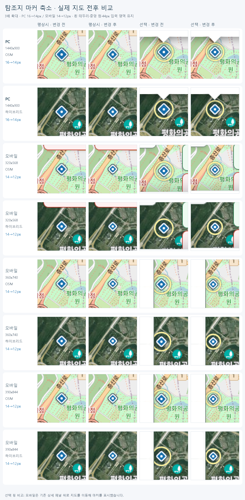

# 탐조지 마커 축소 검증 — 2026-11-01

1. **작업 목적**  
   전국 탐조지도 탐조지 마름모를 PC 16→14px, 모바일 14→12px로 축소했다. 작업 시작 및 PR 준비 직전 main은 `a8f17a42a701b87599f37f7755c4e7ad409c0bbd`로 동일했다.

2. **변경 파일**  
   운영 코드는 `assets/birdmap-markers.css`와 `assets/birdmap-markers.js` 두 파일이다. `docs/marker-visibility/browser.cjs`에는 크기·중심·투명 입력 영역·화면 경계 검증 및 크기 변경 전후 촬영 옵션을 추가했다. 이 폴더는 결과와 비교 이미지를 담는다.

3. **변경 내용**

   | 구분 | 마름모 변 길이 | left/top | 4px 중앙 점 left/top | 탐조지 링 반지름 |
   |---|---:|---:|---:|---:|
   | PC, 700px 초과 | 14px | 15px | 3px | 13.5px |
   | 모바일, 700px 이하 | 12px | 16px | 2px | 12px |

   45도 회전·흰색 2px 테두리·모서리·색·그림자·4px 중앙 점을 유지했다. 마름모와 점의 중심은 44×44px 입력 영역의 (22,22)이다. iconAnchor [22,22], 팝업·툴팁 앵커는 유지했다. 기존 resize 경로에서 선택된 탐조지 링만 새 반지름으로 갱신한다.

4. **테스트 결과**

   | 검사 | 통과 |
   |---|---:|
   | 강화된 마커 클릭·터치·중심·선택·수명 검사 | 529/529 |
   | GPS·팝업·길찾기 | 750/750 |
   | 최근 제보 패널 | 96/96 |
   | 제보 위치 선택·검색·SDK 오류 경로 | 296/296 |
   | 비공개·공개 만료·이전 응답 차단 | 25/25 |
   | 기존 마커 HTML 계약 | 3/3 |
   | 실제 타일 전후 촬영 상태 검사 | 36/36 |

   클릭 회귀는 PC 1440×900·1440×1100, 모바일 320×568·360×740·390×844 및 가로 568×320·740×360·844×390을 OSM·하이브리드 각각에서 실행했다. 투명 입력 영역의 네 가장자리 클릭/터치, 출현종 마커와의 중첩 입력, 회전과 700/701px 경계에서 선택 링, 최근 15건 선택, 닫기·다른 선택·제거·갱신·공개 철회, 2회 pulse 및 reduced-motion을 검사했다.

   실제 OSM·VWorld 하이브리드 타일 캐시를 사용해 PC 1440px와 모바일 320·360·390px의 전후를 촬영했다. API·GPS는 합성 자료를 사용했다. 총 80장(평상시·탐조지 선택·출현종 선택·최근 제보 선택 및 보조 화면)을 확인했고, 타일 실패와 JavaScript 오류는 0건이다.

   100회 선택/닫기: 161.6ms(한 번 측정), 레이어 262→262, 잔여 링 0, 추가 요청 0. 성능 수치는 다른 기기를 보증하지 않는다. 상세 수치는 [results.json](results.json)을 참고한다.

5. **좌표 검증 결과**  
   240개 탐조지 ID 중복 없음, 각 런타임 마커 lat/lng와 siteData 일치를 검사했다. index.html·siteData·Worker 좌표·관찰 기록·보호 정책 데이터는 수정하지 않았다.

6. **기존 기능 영향**  
   출현종 제보 마커의 평상시 모양·10% 선택 확대·진한 강조·링 계산·pulse·pane 우선순위는 유지했다. GPS·길찾기·카카오 링크·최근 제보 및 비공개/만료/공개 철회 처리는 기존 검사에서 통과했다. 독립 읽기 전용 코드 검토에서도 수정할 결함이 발견되지 않았다.

7. **미해결 문제와 검증 한계**  
   이번 범위의 실패는 없다. Chrome 모바일 터치 에뮬레이션이며 물리 기기 Safari는 검사하지 않았다. 기존 모바일 상세 패널이 마커를 덮을 수 있어 선택 링 비교용 보조 화면은 지도를 이동했다. 실제 운영 제보 쓰기나 실제 GPS 위치 사용은 없다. 전체 저장소 CI 통과를 이 표적 검사 결과로 대체하지 않는다.

8. **Commit·Push 및 배포**  
   별도 브랜치 `codex/shrink-site-markers-14-12`의 PR로 제출한다. 정확한 변경 커밋은 해당 PR head를 따른다. main 병합 및 운영 배포는 실행하지 않으며 사용자 최종 승인까지 보류한다.



## 재현

기존 Playwright 1.62.1·설치된 Chrome과 검증된 27개 CDN 캐시를 사용했다. 아래 환경 변수에 실제 경로를 지정한다.

```text
PLAYWRIGHT_MODULE=<playwright-core 경로>
POPUP_DEPENDENCY_CACHE=<CDN 캐시 경로>
MARKER_AFTER_ONLY=1
node docs/marker-visibility/browser.cjs
node docs/current-location/popup-regression.cjs
node docs/recent-reports-controls/browser.cjs
node docs/report-pick-search/browser.cjs
node --test .github/scripts/test_location_protection.mjs .github/scripts/test_publication_visibility_expiry.mjs .github/scripts/test_publication_renewal_margin.mjs .github/scripts/test_location_popup_guard.mjs
python .github/scripts/test_marker_visibility_contract.py
```

전후 촬영 시 MARKER_AFTER_ONLY를 해제하고 `MARKER_BASE_REF=a8f17a42a701b87599f37f7755c4e7ad409c0bbd`, `MARKER_COMPARE_SITE_SIZE=1`, `MARKER_REAL_TILES=1`, `MARKER_CAPTURE_ONLY=1`, `MARKER_CAPTURE_SITE_RING=1`, `MARKER_SHOTS=<출력 폴더>`를 지정한다. `MARKER_SIZE`는 1440x900·320x568·360x740·390x844를 각각 사용했다.
